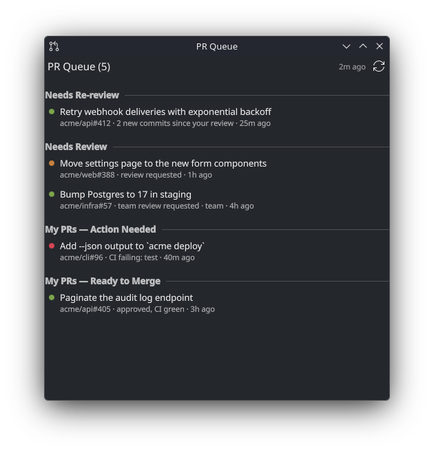

# gh-prq widget

A read-only KDE Plasma 6 widget for [gh-prq](https://github.com/daviddecorso/gh-prq). It shows the PRs where it's your turn: needs review, needs re-review, action needed on your PR, ready to merge.

On a panel it's an icon with a count badge. On the desktop, or when opened, it lists the PRs grouped by bucket, with a CI dot, the reason it's your turn, and how long it has been your turn.



## How it works

Every few minutes it runs `gh prq --json --envelope` and renders the output. All the classification logic stays in gh-prq, and gh-prq's local cache is shared with the CLI and TUI. `--envelope` adds the fetch time and stale-cache status to the output ([daviddecorso/gh-prq PR pending](https://github.com/daviddecorso/gh-prq/pulls)). With a gh-prq that doesn't have it yet, the widget notices the rejected flag and falls back to plain `--json`.

## Install

Needs Plasma 6 and [gh-prq](https://github.com/daviddecorso/gh-prq).

```sh
git clone https://github.com/lucasrossell/gh-prq-widget
cd gh-prq-widget
kpackagetool6 -t Plasma/Applet -i package    # first time
kpackagetool6 -t Plasma/Applet -u package    # after changes
```

Then add **PR Queue** from *Add Widgets…* to a panel or the desktop.

To try it without adding it anywhere: `plasmawindowed io.github.ghprq.widget`. To see it with made-up data instead of your queue, set the command to `cat /path/to/gh-prq-widget/docs/sample.json`.

## Settings

- **Command**: runs through `sh`. If `gh` lives in a distrobox or toolbox, prefix it, e.g. `distrobox enter fedora -- gh prq --json --envelope`. Other gh-prq flags such as `--org acme` or `--exclude 'legacy-*'` work here too.
- **Refresh every**: default 5 minutes.
- **Show PRs waiting on someone else**: off by default.
- **Open a PR in the browser when clicked**: on by default; turn it off for a purely read-only view.

Right-click → *Refresh Now* forces a refresh. Data younger than gh-prq's `ui.cacheTtlSeconds` (30s by default) comes from its cache.

## Uninstall

```sh
kpackagetool6 -t Plasma/Applet -r io.github.ghprq.widget
```

## License

MIT
